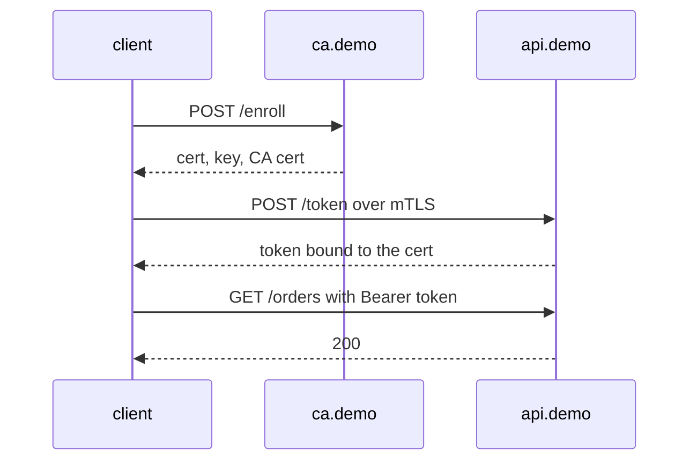

# Guide: certificate-bound tokens with mutual TLS

## What this is

This demo shows AuthN and AuthZ between services. A Java client calls a Python API over mutual TLS (mTLS). The API issues a token that only works on the cert it was issued to.

A real run proves three things: a stolen token fails on another cert, a client without the right scope gets 403, and a cert from an unknown CA never reaches the API code.

## AuthN vs AuthZ, 401 vs 403

AuthN (authentication) is who you are. Here the client cert answers it. AuthZ (authorization) is what you may do. Here the token `scope` answers it.

| Status | Meaning | Example reason |
|---|---|---|
| 401 | Identity or binding failed | `thumbprint_mismatch` |
| 403 | Identity is known, action not allowed | `insufficient_scope` |

## Where the certs come from

The mock CA is a Go service. A service calls `POST /enroll` with a name and a kind (`server` or `client`). The CA replies with a cert, a private key and the CA cert.

```json
{"name": "java-writer", "kind": "client", "dns": [], "issuer": "demo"}
```

This is a mock. The endpoint has no authentication, runs over plain HTTP and returns the private key. A real CA works differently:

- The service makes its own key and sends only a CSR (certificate signing request).
- The CA checks proof of identity before it signs.
- The private key never leaves the service.

The `issuer: "rogue"` option signs with a second CA. The demo uses it to make a cert the API must reject.

## Binding a token to a cert

The API signs an ES256 JWT (a signed token). It carries a `cnf` claim (confirmation) with the SHA-256 thumbprint of the client cert:

```json
{
  "iss": "https://api.demo", "sub": "java-writer", "aud": "api.demo",
  "exp": 1760000300, "scope": "orders:read orders:write",
  "cnf": {"x5t#S256": "<base64url SHA-256 of the cert DER>"}
}
```

On every call the server takes the thumbprint from the TLS connection and compares it with `cnf`. A token used on a different cert fails.

Scopes never come from the request. The server looks up the cert CN in its policy table:

| CN | Scopes |
|---|---|
| `java-writer` | `orders:read orders:write` |
| `java-reader` | `orders:read` |

A CN with no entry gets 403 `no_policy` at `/token`.

On `/orders` the checks run in this order. The first failure ends the request. Only the last one is a 403:

1. Peer cert present (`no_client_cert`, 401)
2. Bearer token parses (`malformed`, 401)
3. Signature and expiry (`bad_signature`, `expired`, 401)
4. Audience (`bad_audience`, 401)
5. Issuer (`bad_issuer`, 401)
6. `cnf` present (`no_cnf`, 401)
7. Thumbprint matches (`thumbprint_mismatch`, 401)
8. Scope allows the call (`insufficient_scope`, 403)

The checks run before the body is parsed. A `POST /orders` with a bad body and no valid token gets 401, not 422. A bad body with a valid token gets 422 `invalid_body`. Unknown paths get 404 `http_404`. All of these are logged.

## The pieces

| Service | Stack | Address | Job |
|---|---|---|---|
| ca | Go | `ca.demo:8080` | Issues certs at `/enroll` |
| api | FastAPI on Hypercorn | `api.demo:8443` | Requires a client cert, issues and checks tokens |
| client | Java 25 | none | Runs the scenarios and sets the exit code |



The api also enrolls at startup to get its own server cert.

## Run it

```sh
podman compose up --build --exit-code-from client
```

Success: every row of the client table says `yes` in the MATCH column and the exit code is 0.

```sh
podman compose down -v
```

Thumbprints differ on every run because the certs are fresh.

## Scenario walk-through

This output comes from a real run. The `api` log lines are trimmed to their text.

```text
SCENARIO                         EXPECTED                   MATCH  ACTUAL
1 writer GET /orders             200                        yes    200
1 writer POST /orders            201                        yes    201
2 reader POST /orders            403 insufficient_scope     yes    403 insufficient_scope
2 reader GET /orders             200                        yes    200
3 reader replays writer token    401 thumbprint_mismatch    yes    401 thumbprint_mismatch
4 rogue cert                     TLS handshake rejected     yes    java.io.IOException: Connection reset
4 control: writer still served   200                        yes    200
```

### 1. Writer reads and writes

The writer gets a token, lists orders and adds one. The API logs three allows: `/token`, `GET`, `POST`.

```text
INFO:app:cn='java-writer' thumbprint=5EeJsK7v decision=allow reason=ok
INFO:app:cn='java-writer' thumbprint=5EeJsK7v decision=allow reason=ok
INFO:app:cn='java-writer' thumbprint=5EeJsK7v decision=allow reason=ok
```

### 2. Reader cannot write

The reader's token has only `orders:read`. Its `POST` passes AuthN and fails AuthZ. The log shows `/token`, the denied `POST`, then a `GET` that succeeds.

```text
INFO:app:cn='java-reader' thumbprint=MviyHwk5 decision=allow reason=ok
INFO:app:cn='java-reader' thumbprint=MviyHwk5 decision=deny reason=insufficient_scope
INFO:app:cn='java-reader' thumbprint=MviyHwk5 decision=allow reason=ok
```

### 3. Replayed token

The reader sends the writer's token on its own connection. The signature is valid. The `cnf` thumbprint is the writer's, so the check fails.

```text
INFO:app:cn='java-reader' thumbprint=MviyHwk5 decision=deny reason=thumbprint_mismatch
```

### 4. Rogue-CA cert

The client enrolls `java-rogue` with `issuer: "rogue"`. The API trusts only the demo CA, so the TLS handshake fails. The API logs nothing, because no handler ran.

The JDK does send this cert. The server's certificate request carries no list of accepted CAs, so the client has no reason to hold it back. The server rejects the cert after the client sends it. The client sees `Connection reset`. Some runs show `EOF reached while reading`.

The control call proves the API was still up. The writer calls again and gets 200:

```text
INFO:app:cn='java-writer' thumbprint=5EeJsK7v decision=allow reason=ok
```

## Gotchas we hit

### The client cert is not in the ASGI scope

Python ASGI servers do not hand the client cert to the app. `app/tls.py` subclasses Hypercorn's `TCPServer`. After the handshake it copies the peer cert into a `ContextVar`. The handler reads it from there.

A test runs concurrent connections and checks that no cert leaks between them. This relies on Hypercorn internals, so the version is pinned.

### Hypercorn allows TLS 1.2

Hypercorn sets a TLS 1.2 floor. A `Config` subclass raises `minimum_version` to TLS 1.3. A test shows a TLS 1.2 client is rejected and no request reaches the app.

### TLS 1.3 shows rejection on the first read

In TLS 1.3 the client finishes its handshake before the server checks the client cert. The client sees the rejection on its first read. So scenario 4 accepts a reset or an EOF as well as an `SSLException`.

### Rejected handshakes are not logged

A failed handshake is never a request, so the API logs nothing. Read the client output instead.

### Started is not ready

Compose `service_started` only means the process began. The api calls the CA at startup, so it waits for the CA healthcheck (`service_healthy`).

## Demo shortcuts and what this does not cover

- `/enroll` is unauthenticated, uses plain HTTP and returns the private key.
- Apps trust the CA cert from that same call (trust on first use).
- There is no rotation or revocation. Certs last 24 hours and tokens 300 seconds.
- A TLS-terminating proxy in front of the API would hide the client cert. The binding would then break.
