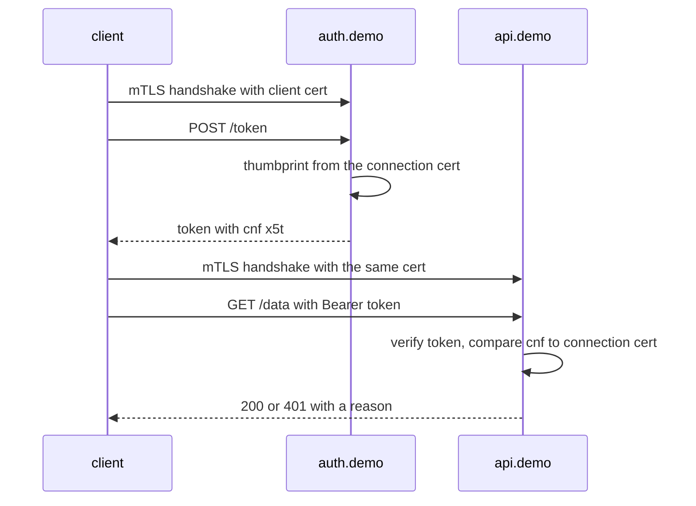

# Guide

## What this is

A runnable demo of certificate-bound access tokens (RFC 8705). The auth server ties each token to the client certificate that asked for it. The API accepts the token only on a connection that presents that same certificate.

One command runs five scenarios against real servers. A stolen token fails, an unbound token fails and a bad certificate never connects.

## The problem with bearer tokens

A bearer token works for whoever holds it. If an attacker copies it from a log, the API cannot tell the attacker from the real client. The stolen token works from anywhere until it expires.

## mTLS in 60 seconds

In plain TLS only the server shows a certificate. In mutual TLS (mTLS) the client shows one too. The handshake proves the client holds the private key for that certificate.

The server now knows which certificate sits on the other end. A CN is only text inside the cert, so the binding below uses the certificate itself.

## Binding a token to a cert

The token carries a `cnf` (confirmation) claim. Its `x5t#S256` member is the SHA-256 of the client certificate DER bytes, base64url encoded with no padding.

```json
{"iss":"https://auth.demo","sub":"client-a","aud":"api.demo","exp":1789000000,
 "cnf":{"x5t#S256":"jZfEKqAO..."}}
```

The auth server takes the thumbprint from the TLS connection (`r.TLS.PeerCertificates[0]`). It never reads it from the request. If the client could name the thumbprint, it could ask for a token bound to someone else's cert, and the binding would prove nothing.

The API recomputes the thumbprint from its own connection and compares. A thief with the token but a different key fails that comparison.

## The pieces

| Service | Host name | Role |
|---|---|---|
| `ca` | | Writes the CA, client certs and signing key to a shared volume |
| `authserver` | `auth.demo` | Issues ES256 tokens bound to the caller's cert |
| `resource` | `api.demo` | Serves `/data` after checking the token and the cert |
| `verify` | | Plays the clients, runs five scenarios and sets the exit code |



## Run it

```sh
podman compose up --build --exit-code-from verify
```

`verify` prints one row per scenario. MATCH is `true` when the result equals the expected one. The exit code is 0 only if all five rows match.

Clean up with `podman compose down -v`. Certs are fresh on every run, so the thumbprints in this guide differ from yours.

## Scenario walk-through

All output below comes from a real run. Timestamps and addresses are trimmed.

### 1. Happy path

`client-a` gets a token and calls the API.

```
authserver-1  | cn=client-a thumb=jZfEKqAO decision=allow reason=ok
resource-1    | cn="client-a" thumb=jZfEKqAO decision=allow reason=ok
verify-1      | 1 client-a, own token     200 ok                   true   200 ok
```


### 2. Stolen token

`client-b` replays `client-a`'s token. The signature and claims are valid. The connection cert is not the bound one.

```
resource-1    | cn="client-b" thumb=e-3Vqx7m decision=deny reason=thumbprint_mismatch
verify-1      | 2 client-b replays token  401 thumbprint_mismatch  true   401 thumbprint_mismatch
```

### 3. Unbound token

`verify` signs a token with the real signing key but leaves out `cnf`. The API rejects it. Accepting it would turn the token back into a bearer token.

```
resource-1    | cn="client-a" thumb=jZfEKqAO decision=deny reason=no_cnf
verify-1      | 3 token without cnf       401 no_cnf               true   401 no_cnf
```

### 4. Expired cert

`client-expired` has a backdated `NotAfter`. The server rejects it in the handshake.

```
resource-1    | http: TLS handshake error from 10.89.1.5:56508: tls: failed to verify certificate: x509: certificate has expired or is not yet valid: current time 2026-11-11T00:17:21Z is after 2026-11-10T00:17:21Z
verify-1      | 4 expired client cert     tls rejected             true   tls rejected: Get "https://api.demo:8443/data": remote error: tls: expired certificate
```

### 5. Rogue-CA cert

`client-rogue` is signed by a second CA that the servers do not trust. The client side shows `certificate required`.

```
resource-1    | http: TLS handshake error from 10.89.1.5:56522: tls: client didn't provide a certificate
verify-1      | 5 rogue-CA client cert    tls rejected             true   tls rejected: Get "https://api.demo:8443/data": remote error: tls: certificate required
```

The reason: the server lists the CAs it trusts in its CertificateRequest. The Go client presents a cert only if a CA on that list issued it. The rogue cert's issuer is not listed, so the client sends no cert at all. The server logs `client didn't provide a certificate`.

## Gotchas we hit

- **TLS 1.3 rejections arrive late.** The client finishes its handshake before the server checks the client cert. The error (`expired certificate`, `certificate required`) shows up on the first read, so `verify` treats any error from `client.Do` as the rejection.
- **Check order on the resource server.** Cert present, token parses, signature and expiry, audience, `cnf` present, thumbprint match.
- **"Started" is not "ready".** The servers need the certs before they start. `ca` creates `/certs/.ready` and a healthcheck on that file gates them with `service_healthy`.
- **`--exit-code-from` aborts on any exit.** A one-shot `ca` that exits 0 still stops the stack. So `ca` stays alive.
- **Stale `.ready` on a reused volume.** The `certs` volume survives `down` without `-v`. `ca` runs `rm -f /certs/.ready` first so the healthcheck cannot pass early.

## What this does not cover

- **Key rotation.** One signing key, never replaced.
- **Revocation.** There is no way to cancel a token or a cert before it expires.
- **JWKS.** The resource server reads the public key from the shared volume. A real deployment fetches it from a JWKS endpoint.
- **TLS-terminating proxies.** If a proxy ends the TLS connection, the resource server never sees the client cert and cannot check the binding. Pass the cert on and trust only that proxy, or check at the proxy.
- **Key isolation.** Every service can read every file in the shared volume, including `signing.key` and all client keys. That is a demo shortcut.
