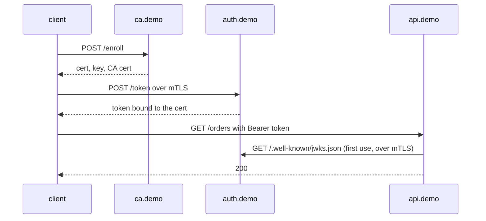

# Guide: certificate-bound tokens with mutual TLS

## What this is

This demo shows AuthN and AuthZ between services. A Java client calls a Python API over mutual TLS (mTLS). A separate auth server issues a token that only works on the cert (or the DPoP key) it was issued to.

A real run proves these things:

- A stolen token fails on another cert.
- A client without the right scope gets 403.
- A cert from an unknown CA never reaches the API code.
- A token signed by an unknown key fails against the JWKS.
- A token can be narrowed by exchange but never widened.
- REST and gRPC apply the same checks.
- A DPoP proof must match its token, method, URL and one-time id.

## AuthN vs AuthZ, 401 vs 403

AuthN (authentication) is who you are. Here the client cert answers it. AuthZ (authorization) is what you may do. Here the token `scope` answers it.

| Status | Meaning | Example reason |
|---|---|---|
| 401 | Identity or binding failed | `thumbprint_mismatch` |
| 403 | Identity is known, action not allowed | `insufficient_scope` |

## Where the certs come from

The mock CA is a Go service. A service calls `POST /enroll` with a name and a kind (`server` or `client`). The request carries a CSR and an enrollment secret. The CA replies with a cert and the CA cert, never a private key.

```json
{"name": "java-writer", "kind": "client", "dns": [], "issuer": "demo"}
```

This is a mock. The endpoint has no authentication, runs over plain HTTP and returns the private key. A real CA works differently:

- The service makes its own key and sends only a CSR (certificate signing request).
- The CA checks proof of identity before it signs.
- The private key never leaves the service.

The `issuer: "rogue"` option signs with a second CA. The demo uses it to make a cert the API must reject.

## Binding a token to a cert

The auth server signs an ES256 JWT (a signed token). It carries a `cnf` claim (confirmation) with the SHA-256 thumbprint of the client cert:

```json
{
  "iss": "https://auth.demo:8443", "sub": "java-writer", "aud": "api.demo",
  "exp": 1760000300, "scope": "orders:read orders:write",
  "cnf": {"x5t#S256": "<base64url SHA-256 of the cert DER>"}
}
```

On every call the API takes the thumbprint from the TLS connection and compares it with `cnf`. A token used on a different cert fails. This is RFC 8705.

Scopes never come from the request. The server looks up the cert CN in its policy table:

| CN | Scopes |
|---|---|
| `java-writer` | `orders:read orders:write` |
| `java-reader` | `orders:read` |

A CN with no entry gets 403 `no_policy` at `/token` on the auth server.

On `/orders` the checks run in this order. The first failure ends the request. Only the last one is a 403:

1. Peer cert present (`no_client_cert`, 401)
2. Authorization header parses (`malformed`, 401)
3. Signature and expiry (`bad_signature`, `expired`, 401). The key comes from the JWKS by `kid`. An unknown `kid` is `bad_signature`.
4. Audience (`bad_audience`, 401)
5. Issuer (`bad_issuer`, 401)
6. Binding: for a Bearer token, `cnf` present (`no_cnf`) and the thumbprint matches (`thumbprint_mismatch`). A DPoP token takes the DPoP checks instead (see [DPoP](#dpop)). All 401.
7. Scope allows the call (`insufficient_scope`, 403)

REST and gRPC share this code. The server runs the checks before it parses the body. A `POST /orders` with a bad body and no valid token gets 401, not 422. A bad body with a valid token gets 422 `invalid_body`. Unknown paths get 404 `http_404`. The server logs all of these.

## The pieces

| Service | Stack | Address | Job |
|---|---|---|---|
| ca | Go | `ca.demo:8080` | Issues certs at `/enroll` |
| auth | FastAPI on Hypercorn | `auth.demo:8443` | Requires a client cert. Issues tokens at `/token`, does token exchange, serves the JWKS |
| api | FastAPI on Hypercorn, grpcio | `api.demo:8443` REST, `api.demo:9443` gRPC | Resource server. Requires a client cert and checks tokens. Holds no signing key |
| client | Java 25 | none | Runs the scenarios and sets the exit code |

Auth and api run from one Python image with two entry points (`python -m app.auth`, `python -m app.api`). They are separate containers.



Auth and api enroll at startup with kind `both`. Each is a TLS server, and the api is also a TLS client when it fetches the JWKS.

## Run it

```sh
podman compose --env-file .env.local up --build --exit-code-from client
```

Success: every row of the client table says `yes` in the MATCH column and the exit code is 0.

```sh
podman compose --env-file .env.local down -v
```

Thumbprints differ on every run because the certs are fresh.

## Container hardening

All four services share the limits in `compose.yaml`.

| Control | Where | Why |
|---|---|---|
| Non-root user `65534:65534` | `USER` in each Containerfile | A bug in a service does not give root in the container. All ports are above 1024, so no privilege is needed. |
| Read-only root filesystem | `read_only: true` | A compromised process cannot change the image. |
| tmpfs mounts | `tmpfs: [/tmp]` | Auth and api write their cert files to `/tmp` and the JVM uses it. Podman also mounts writable tmpfs on `/var/tmp` and `/dev/shm`, so those paths are writable too. The files vanish when the container stops. |
| No capabilities | `cap_drop: [ALL]` | No service needs one. |
| No privilege gain | `no-new-privileges:true` | A setuid binary cannot raise privileges. |
| Healthchecks | `ca`: `wget` on `/healthz`. `auth`: a TCP connect to port 8443. `api`: a TCP connect to ports 8443 and 9443. | `depends_on` waits for `service_healthy`, so each service starts after the one it calls. The api waits for auth, and the client waits for both. A TCP connect needs no client cert. |

To check that a service is not root:

```sh
podman compose --env-file .env.local up -d ca auth api
podman exec mtlsdemo-api-1 id
podman compose --env-file .env.local down -v
```

Expect `uid=65534(nobody)`. The client container exits after its run. Check its image with `podman image inspect mtlsdemo-client --format '{{.Config.User}}'`.

### Build context

- The root `.containerignore` is an allowlist: it keeps `go.mod`, `cmd` and `internal` and drops the rest. That is why the CA Containerfile can use one `COPY . .`. If you add Go dependencies, copy `go.mod` and `go.sum` first and run `go mod download` before `COPY . .`.
- `api/.containerignore` and `client/.containerignore` are allowlists too. The api context keeps `requirements.txt` and `app/`. The client context keeps `pom.xml` and `src/`. The `.venv` alone was 60 MB. All three `.containerignore` files also exclude `.env*` files, including inside the allowed directories.
- Base images use full `docker.io/library/` names with version tags. They are not pinned by digest, so a tag can change under you.
- Maven resolves dependencies in its own layer, so a source edit does not download them again.
- The Go binary builds with `CGO_ENABLED=0`, `-trimpath` and stripped symbols, so it runs on plain Alpine.

## Scenario walk-through

This output comes from a real run. Log lines show the service and the message after `INFO:app:`. Thumbprints and the `kid` change on every run.

```text
SCENARIO                                 EXPECTED                                     MATCH  ACTUAL
1 writer GET /orders                     200                                          yes    200
1 writer POST /orders                    201                                          yes    201
2 reader POST /orders                    403 insufficient_scope                       yes    403 insufficient_scope
2 reader GET /orders                     200                                          yes    200
3 reader replays writer token            401 thumbprint_mismatch                      yes    401 thumbprint_mismatch
4 rogue cert                             TLS handshake rejected                       yes    java.io.IOException: EOF reached while reading
4 control: writer still served           200                                          yes    200
5 attacker enrolls, no secret            403 enroll refused                           yes    403
5 attacker enrolls, wrong secret         403 enroll refused                           yes    403
6 forged token, key not in JWKS          401 bad_signature                            yes    401 bad_signature
6 forged signature, real kid             401 bad_signature                            yes    401 bad_signature
7 writer exchanges down to orders:read   200                                          yes    200
7 narrowed token GET /orders             200                                          yes    200
7 narrowed token POST /orders            403 insufficient_scope                       yes    403 insufficient_scope
7 reader asks orders:write               400 invalid_scope scope_not_allowed          yes    400 invalid_scope scope_not_allowed
7 reader uses writer subject token       400 invalid_grant thumbprint_mismatch        yes    400 invalid_grant thumbprint_mismatch
7 unknown audience                       400 invalid_target audience_not_allowed      yes    400 invalid_target audience_not_allowed
8 grpc writer Add                        OK                                           yes    OK
8 grpc writer List                       OK                                           yes    OK
8 grpc reader Add                        PERMISSION_DENIED insufficient_scope         yes    PERMISSION_DENIED insufficient_scope
8 grpc reader List                       OK                                           yes    OK
8 grpc reader replays writer token       UNAUTHENTICATED thumbprint_mismatch          yes    UNAUTHENTICATED thumbprint_mismatch
8 grpc rogue cert                        TLS handshake rejected                       yes    UNAVAILABLE Network closed for unknown reason
8 grpc control: writer still served      OK                                           yes    OK
9 dpop GET /orders                       200                                          yes    200
9 dpop POST /orders                      201                                          yes    201
9 dpop proof from other key              401 dpop_jkt_mismatch                        yes    401 dpop_jkt_mismatch
9 dpop wrong htu                         401 dpop_htu                                 yes    401 dpop_htu
9 dpop wrong htm                         401 dpop_htm                                 yes    401 dpop_htm
9 dpop reused jti                        401 dpop_replay                              yes    401 dpop_replay
9 dpop token as Bearer                   401 dpop_required                            yes    401 dpop_required
```

### 1. Writer reads and writes

The writer gets a token from auth, lists orders and adds one. The auth server logs one allow. The API logs two: `GET`, `POST`.

```text
auth-1  | INFO:app:cn='java-writer' thumbprint=a1aXyWQN decision=allow reason=ok
api-1   | INFO:app:cn='java-writer' thumbprint=a1aXyWQN decision=allow reason=ok
api-1   | INFO:app:cn='java-writer' thumbprint=a1aXyWQN decision=allow reason=ok
```

### 2. Reader cannot write

The reader's token has only `orders:read`. Its `POST` passes AuthN and fails AuthZ. The log shows `/token` on auth, then on the API the denied `POST` and a `GET` that succeeds.

```text
auth-1  | INFO:app:cn='java-reader' thumbprint=NgDOKjQD decision=allow reason=ok
api-1   | INFO:app:cn='java-reader' thumbprint=NgDOKjQD decision=deny reason=insufficient_scope
api-1   | INFO:app:cn='java-reader' thumbprint=NgDOKjQD decision=allow reason=ok
```

### 3. Replayed token

The reader sends the writer's token on its own connection. The signature is valid. The `cnf` thumbprint is the writer's, so the check fails.

```text
api-1   | INFO:app:cn='java-reader' thumbprint=NgDOKjQD decision=deny reason=thumbprint_mismatch
```

### 4. Rogue-CA cert

The client enrolls `java-rogue` with `issuer: "rogue"`. The API trusts only the demo CA, so the TLS handshake fails. The API logs nothing, because no handler ran.

The JDK does send this cert. The server's certificate request carries no list of accepted CAs, so the client has no reason to hold it back. The server rejects the cert after the client sends it. The client sees `Connection reset`. Some runs show `EOF reached while reading`.

The control call proves the API was still up. The writer calls again and gets 200:

```text
api-1   | INFO:app:cn='java-writer' thumbprint=a1aXyWQN decision=allow reason=ok
```

### 5. Attacker enrolls as the writer

Scopes follow the cert CN, so the CA must check who asks for `java-writer`. Without the `X-Enroll-Secret` header, or with a wrong one, the CA answers 403 and issues nothing. The legitimate writer enrolled with its secret, so scenarios 1 to 3 are the control.

A CSR and a secret fix different things. The CSR keeps the private key off the network and proves the requester holds it. The secret decides who may have the name.

### 6. Forged token, key not in the JWKS

The client signs its own ES256 token. It copies the claims of a real writer token and sets a `kid`. The cert is the real writer cert, so only the signature check can stop it.

The API finds no such `kid` in the JWKS. It tries one refetch (see [JWKS and rotation](#jwks-and-rotation)), still finds nothing, and answers `bad_signature`. An unknown `kid` and a wrong signature look the same, so the API does not tell an attacker which `kid`s exist.

```text
api-1   | INFO:app:cn='java-writer' thumbprint=a1aXyWQN decision=deny reason=bad_signature
```

### 7. Token exchange

The writer trades its token for a narrower one. Auth logs the exchange, and the API logs the calls with the new token.

```text
auth-1  | INFO:app:cn='java-writer' thumbprint=a1aXyWQN decision=allow reason=ok
api-1   | INFO:app:cn='java-writer' thumbprint=a1aXyWQN decision=allow reason=ok
api-1   | INFO:app:cn='java-writer' thumbprint=a1aXyWQN decision=deny reason=insufficient_scope
auth-1  | INFO:app:cn='java-reader' thumbprint=NgDOKjQD decision=deny reason=scope_not_allowed
auth-1  | INFO:app:cn='java-reader' thumbprint=NgDOKjQD decision=deny reason=thumbprint_mismatch
auth-1  | INFO:app:cn='java-writer' thumbprint=a1aXyWQN decision=deny reason=audience_not_allowed
```

In order, the lines show:

- The exchange to `orders:read` succeeds. The narrowed token reads (`GET` allowed) and cannot write (`POST` 403).
- The reader asks for `orders:write`: 400 `invalid_scope`.
- The reader presents the writer's subject token: 400 `invalid_grant`, `thumbprint_mismatch`.
- The writer asks for an audience it has no policy for: 400 `invalid_target`.

### 8. gRPC

The same checks run over gRPC on port 9443. The API logs gRPC calls with a `grpc` prefix. The auth `/token` lines are as above and are left out.

```text
api-1   | INFO:app:grpc cn='java-writer' thumbprint=a1aXyWQN decision=allow reason=ok
api-1   | INFO:app:grpc cn='java-writer' thumbprint=a1aXyWQN decision=allow reason=ok
api-1   | INFO:app:grpc cn='java-reader' thumbprint=NgDOKjQD decision=deny reason=insufficient_scope
api-1   | INFO:app:grpc cn='java-reader' thumbprint=NgDOKjQD decision=allow reason=ok
api-1   | INFO:app:grpc cn='java-reader' thumbprint=NgDOKjQD decision=deny reason=thumbprint_mismatch
```

The 401 reasons map to `UNAUTHENTICATED`, and `insufficient_scope` maps to `PERMISSION_DENIED`. The reason is the status message.

The rogue cert fails at the handshake. The client sees `UNAVAILABLE Network closed for unknown reason`, not a certificate error. gRPC core, not the app, logs the rejection, and the app logs no decision line:

```text
api-1   | I1115 19:19:52.473716       7 ssl_transport_security.cc:2563] Handshake failed with error SSL_ERROR_SSL: error:1000007d:SSL routines:OPENSSL_internal:CERTIFICATE_VERIFY_FAILED: unable to get local issuer certificate
```

### 9. DPoP

The writer asks auth for a DPoP token, then calls REST with `Authorization: DPoP` plus a proof (see [DPoP](#dpop)). The auth line is the DPoP token issue. The next two are the valid `GET` and `POST`. Then come the other-key, wrong-`htu` and wrong-`htm` proofs. The reused-jti row logs its first use (allow) and then the replay. The last line is the DPoP token sent as Bearer.

```text
auth-1  | INFO:app:cn='java-writer' thumbprint=a1aXyWQN decision=allow reason=ok
api-1   | INFO:app:cn='java-writer' thumbprint=a1aXyWQN decision=allow reason=ok
api-1   | INFO:app:cn='java-writer' thumbprint=a1aXyWQN decision=allow reason=ok
api-1   | INFO:app:cn='java-writer' thumbprint=a1aXyWQN decision=deny reason=dpop_jkt_mismatch
api-1   | INFO:app:cn='java-writer' thumbprint=a1aXyWQN decision=deny reason=dpop_htu
api-1   | INFO:app:cn='java-writer' thumbprint=a1aXyWQN decision=deny reason=dpop_htm
api-1   | INFO:app:cn='java-writer' thumbprint=a1aXyWQN decision=allow reason=ok
api-1   | INFO:app:cn='java-writer' thumbprint=a1aXyWQN decision=deny reason=dpop_replay
api-1   | INFO:app:cn='java-writer' thumbprint=a1aXyWQN decision=deny reason=dpop_required
```

The `thumbprint` field is still the TLS cert's. A DPoP token is bound to the proof key, not to the cert.

## JWKS and rotation

The auth server publishes its public signing keys at `/.well-known/jwks.json` (RFC 7517). Each token header carries a `kid`. The API looks the key up by `kid`. It holds no signing key.

The API fetches the JWKS over mTLS with its own cert. It warms the cache at startup (`JWKS fetch OK kids=[...]`).

- A cached key lives 300 seconds.
- An unknown `kid` forces a refetch, but at most once every 10 seconds.
- A failed fetch keeps the old keys. With no cache it fails closed as `bad_signature`.

Auth keeps two keys: the newest signs, and the previous one stays published. A token signed before a rotation still verifies until the next rotation. Pytest covers rotation. No client scenario rotates keys, because it would need an extra endpoint and identity. Keys live in memory, so a restart invalidates old tokens.

## Token exchange

RFC 8693 lets a client trade a token for a narrower one. The client posts `grant_type=urn:ietf:params:oauth:grant-type:token-exchange` to `/token` with the subject token, an `audience` and an optional `scope`.

The auth server checks in this order:

1. Client cert present.
2. Subject token valid (signature, expiry, issuer, audience).
3. Subject `cnf` matches this connection's cert.
4. Audience is in the policy for this CN.
5. Requested scope is a subset of both the subject token and the policy.

The new token keeps the same `cnf`, so it stays bound to the same cert. Errors are 400 with an RFC 6749 `error` and our reason in `error_description`. Exchange of a DPoP token is refused (`dpop_subject_unsupported`).

## DPoP

DPoP (RFC 9449) binds a token to a key the client holds, not to the TLS cert. The client sends a signed proof with each call. This helps when a proxy ends TLS and hides the cert.

The auth server issues a token with `cnf.jkt`, the RFC 7638 thumbprint of the client's proof key, and `token_type: DPoP`. The client cert is still required for the TLS connection. The token carries no `x5t#S256`.

The API checks the proof on each call:

- Signature, using the key in the proof header, and that key's thumbprint equals `cnf.jkt`.
- `htm` equals the request method, and `htu` equals `API_PUBLIC_URL` plus the path. The base URL is configured, not taken from the Host header.
- `iat` is recent, and `ath` is the hash of the access token.
- `jti` has not been seen. The API keeps seen ids in memory for 120 seconds.

A DPoP token sent as Bearer is `dpop_required`. A cert-bound token sent as DPoP is `bearer_required`. gRPC accepts Bearer only, so a DPoP token on gRPC is `dpop_required`.

## Why the Java gRPC client fetches its own token

The Java client gets its token with its own code (`TokenSource`) over mTLS. It does not use gRPC's built-in STS credentials client.

The built-in client calls the token server without a client cert (grpc-go issue 5099, referenced in the salrashid123/cert_bound_sts_server README). The auth server then never sees a cert, so it cannot bind the token to one.

`TokenSource` reuses the same cert and key as the channel. It caches the token and refreshes it 30 seconds before `expires_in`. A `CallCredentials` adds `authorization: Bearer <token>` to each call.

- Code: [TokenSource.java](../client/src/main/java/demo/TokenSource.java), [OrdersGrpc.java](../client/src/main/java/demo/OrdersGrpc.java)

## Gotchas we hit

### The client cert is not in the ASGI scope

Python ASGI servers do not hand the client cert to the app. `app/tls.py` subclasses Hypercorn's `TCPServer`. After the handshake it copies the peer cert into a `ContextVar`. The handler reads it from there.

A test runs concurrent connections and checks that no cert leaks between them. This relies on Hypercorn internals, so we pin the version.

### Hypercorn allows TLS 1.2

Hypercorn sets a TLS 1.2 floor. A `Config` subclass raises `minimum_version` to TLS 1.3. A test shows the server rejects a TLS 1.2 client and no request reaches the app.

### gRPC still accepts TLS 1.2

This is a known limit. grpcio has no minimum-version option. `GRPC_SSL_CIPHER_SUITES` takes only TLS 1.2 cipher names, so a TLS 1.3-only list is rejected as an invalid cipher list. A TLS 1.2 client can still connect on port 9443. The client cert is still required and checked. A test pins both facts (1.3 negotiates, 1.2 is accepted). REST stays TLS 1.3 only.

### TLS 1.3 shows rejection on the first read

In TLS 1.3 the client finishes its handshake before the server checks the client cert. The client sees the rejection on its first read. So scenario 4 accepts a reset or an EOF as well as an `SSLException`. On gRPC the same rejection shows as `UNAVAILABLE` on the first call, not when the channel is built.

### Rejected handshakes are not logged

A failed handshake is never a request, so the API logs no decision line. Read the client output instead. On gRPC the core library prints a handshake error, but that is not an app decision.

### A started container is not a ready one

Compose `service_started` only means the process began. The auth server calls the CA at startup, so it waits for the CA healthcheck (`service_healthy`). The api waits for auth, and the client waits for both, in the same way.

### Duplicate authorization headers

On gRPC, two `authorization` metadata values count as missing and give `malformed`.

## Demo shortcuts and what this does not cover

- `/enroll` uses plain HTTP, and the enrollment secrets are random per machine in `.env.local`, not a real secret store. A compromised client that holds the `java-writer` secret can still enroll as the writer.
- Apps trust the CA cert from that same call (trust on first use).
- Certs last 24 hours and tokens 300 seconds. Nothing renews or revokes certs. Auth signing keys rotate only through code, not through an endpoint.
- The DPoP `jti` cache is in memory in one process. DPoP has no server nonce.
- A TLS-terminating proxy in front of the API hides the client cert. A cert-bound token would then break. DPoP does not need the cert.
- gRPC accepts TLS 1.2 (see above).
